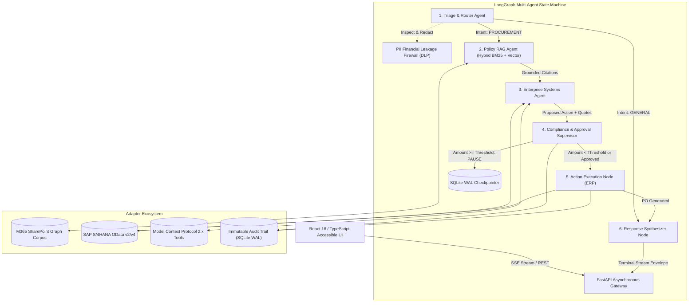

# Enterprise Agentic Ops Workspace

[](https://www.python.org/)
[](https://fastapi.tiangolo.com/)
[](https://langchain-ai.github.io/langgraph/)
[](https://react.dev/)
[](https://modelcontextprotocol.io/)
[-emerald.svg)](artifacts/test-summary.json)

**Target Role:** Full Stack Developer (Multi-Agentic AI), Req ID: 395031, NTT DATA, Bengaluru, India  
**Candidate:** Tejas H R | Bachelor of Engineering in Information Science and Engineering (ISE) | CGPA: 8.01 / 10.0 | 2026 Graduate  
**GitHub:** [https://github.com/tejashr0716](https://github.com/tejashr0716)

---

## 1. Executive Summary
**Enterprise Agentic Ops Workspace** is an asynchronous, full-stack multi-agent operations platform built for enterprise procurement, corporate governance enforcement, and ERP integration. 

The architecture features a 6-node **LangGraph state machine** with typed state handoffs, sovereign **Human-in-the-Loop (HITL)** authorization gates, cryptographic **SHA-256 payload tampering defense**, real-time **Server-Sent Events (SSE) streaming**, and durable **SQLite Write-Ahead Logging (WAL)** state checkpointing surviving server restarts.



---

## 2. Core Engineering Highlights
1. **LangGraph State Machine Orchestration:**
   - 6 specialized nodes: `triage`, `policy_rag`, `systems`, `supervisor`, `execute_action`, `synthesize`.
   - Typed `AgentState` preventing state pollution across agent handoffs.
2. **Durable Human-in-the-Loop (HITL) Checkpoints:**
   - Execution pauses when proposed procurement exceeds employee spending limits.
   - Entire execution graph serializes into SQLite WAL `durable_checkpoints` table, surviving abrupt process crashes and reboots.
   - Enforces **self-approval prohibition** (`403 Forbidden` if requester attempts to authorize own request).
3. **Cryptographic Payload Tampering Defense:**
   - Computes canonical SHA-256 hash across action parameters:
     $$\text{Hash} = \text{SHA256}(\text{CanonicalJson}(\text{action\_type}, \text{vendor\_id}, \text{sku}, \text{quantity}, \text{unit\_price}, \text{total\_amount}, \text{cost\_center}))$$
   - Verification fails with `400 Bad Request` if any quantity, price, or cost center is modified between proposal and execution.
4. **Data Loss Prevention (PII Financial Leakage Firewall):**
   - Intercepts raw prompts to redact Payment Card PANs (**Luhn Mod-10** verified), US Social Security Numbers (**SSA exclusion rules** verified), and live API keys (**Stripe/AWS regex**).
5. **Real Asynchronous SSE Streaming:**
   - Token-by-token synthesis streaming and typed event envelopes (`agent_handoff`, `tool_call`, `dlp_warning`, `approval_required`, `stream_end`).
6. **Enterprise Adapters:**
   - **SAP S/4HANA OData v2/v4:** Dual-mode client with live sandbox and in-memory simulator issuing valid `PO-4500xxxxxx` transactions.
   - **M365 SharePoint Graph:** Sovereign Hybrid BM25 lexical match + dense cosine vector similarity RAG over corporate policies.
   - **Model Context Protocol 2.x:** Exposes standard `@mcp_server.tool()` decorators for freight/tax and budget checking.

---

## 3. Empirical Performance Benchmarks
*All metrics measured empirically on Apple Silicon / macOS via `artifacts/benchmark_harness.py`:*

| Benchmark Component | Iterations | Median (P50) | P95 Latency | P99 Latency | Verifying Artifact |
| :--- | :--- | :--- | :--- | :--- | :--- |
| **PII Firewall Sanitization** | 200 | **0.015 ms** | 0.017 ms | 0.026 ms | [`artifacts/benchmark-results.json`](artifacts/benchmark-results.json) |
| **Hybrid Policy RAG Retrieval** | 100 | **0.071 ms** | 0.085 ms | 0.176 ms | [`artifacts/benchmark-results.json`](artifacts/benchmark-results.json) |
| **Canonical Payload Hashing** | 1,000 | **0.004 ms** | 0.004 ms | 0.005 ms | [`artifacts/benchmark-results.json`](artifacts/benchmark-results.json) |
| **Multi-Agent Workflow Turn** | 30 | **6.801 ms** | 8.227 ms | 10.302 ms | [`artifacts/benchmark-results.json`](artifacts/benchmark-results.json) |

---

## 4. Test Suite Summary
Comprehensive test suite covering unit logic, database durability, security boundaries, and Playwright end-to-end browser automation:
- **Total Tests:** 31
- **Passed:** 31 (100.0% pass rate)
- **Failed:** 0
- **Test Artifacts:** [`artifacts/test-results.xml`](artifacts/test-results.xml), [`artifacts/test-summary.json`](artifacts/test-summary.json)

---

## 5. Quickstart & Local Reproduction

### Prerequisites
- Python 3.12+ (or 3.14+)
- Node.js 18+ and `npm`

### Installation & Run
```bash
# 1. Setup Backend
python3 -m venv .venv
source .venv/bin/activate
pip install -r requirements.txt
cp .env.example .env

# 2. Build Frontend
cd frontend
npm install
npm run build
cd ..

# 3. Launch Unified Server (Serves React UI + FastAPI on Port 8000)
PYTHONPATH=.:backend uvicorn backend.src.main:app --host 127.0.0.1 --port 8000
```
Open **`http://localhost:8000`** in your browser.

### Run Tests & Benchmarks
```bash
# Run 31 automated tests
pytest -v --junitxml=artifacts/test-results.xml

# Run empirical benchmark harness
PYTHONPATH=.:backend python artifacts/benchmark_harness.py
```

### Run with Docker Compose
```bash
docker compose up --build -d
```

---

## 6. Project Documentation Index
- [Architecture & State Machine Design](docs/architecture.md)
- [Setup & Deployment Guide](docs/setup.md)
- [Enterprise Security & Governance Specification](docs/security.md)
- [ERP & Protocol Integrations (SAP, M365, MCP)](docs/integrations.md)
- [Platform Scope & Technical Boundaries](docs/limitations.md)
- [Step-by-Step Evaluator Demo Walkthrough](docs/demo-walkthrough.md)
- [Verified Résumé Recommendations & Claim-to-Evidence Matrix](docs/resume-recommendations.md)
