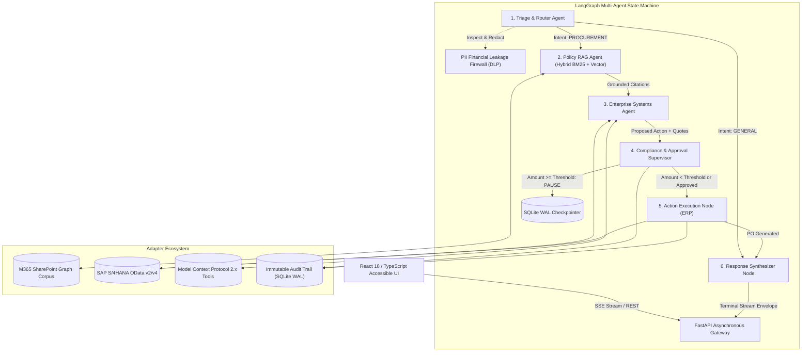

# System Architecture: Enterprise Agentic Ops Workspace

## 1. Architectural Overview
The **Enterprise Agentic Ops Workspace** is an asynchronous, multi-agent enterprise procurement and corporate governance engine tailored to NTT DATA's **Full Stack Developer (Multi-Agentic AI)** specification (Req ID: 395031).

The platform bridges enterprise corporate knowledge repositories (Microsoft 365 SharePoint), Enterprise Resource Planning (ERP) systems (SAP S/4HANA OData), and tool protocols (Model Context Protocol 2.x) with sovereign Human-in-the-Loop (HITL) authorization gates.

---

## 2. Multi-Agent Roles and State Machine Transitions

| Agent Node | Primary Responsibility | Input Context | State Mutation / Output |
| :--- | :--- | :--- | :--- |
| **`triage`** | Inspects input for PII, redacts sensitive PANs/SSNs, and classifies intent (`PROCUREMENT_REQUISITION`, `POLICY_INQUIRY`, `VENDOR_QUOTE`, `GENERAL`). | Raw user prompt | Sanitized prompt, intent classification, handoff events. |
| **`policy_rag`** | Queries sovereign SharePoint governance policies using Hybrid BM25 lexical match + dense cosine vector similarity, filtering strictly by user's `AccessTier`. | Sanitized prompt, user access tier | `policy_citations` list with relevance scores and section citations. |
| **`systems`** | Interlaces with SAP S/4HANA OData catalog to retrieve verified supplier quotes, invokes MCP tools for statutory freight/GST calculation and cost center budget checks. | Extracted item/quantity, user department | `vendor_quotes`, `mcp_logistics`, `mcp_budget`, and initial `proposed_action`. |
| **`supervisor`** | Enforces deterministic corporate governance rules (e.g. prohibited grey-market vendors in Section 4.2), evaluates financial approval thresholds ($1,000 manager, $10,000 executive), computes canonical SHA-256 payload hash, and pauses workflow. | `proposed_action`, user spending limit, user role | Pending `approval_id`, `status: WAITING_APPROVAL`, durable SQLite WAL checkpoint. |
| **`execute_action`** | Resumes upon authorized human approval, verifies cryptographic payload hash integrity, prevents self-approval, commits purchase order to SAP S/4HANA OData endpoint (`PO-4500xxxxxx`), and records audit log. | Approved action, approver identity | `execution_result` with purchase order number and ERP committed status. |
| **`synthesize`** | Formats multi-agent findings, grounded policy citations, supplier quotes, logistics taxes, and execution results into accessible markdown for SSE streaming. | Entire accumulated state | `output_text` token stream. |

---

## 3. Human-in-the-Loop (HITL) Checkpointing & Restart Durability

### 3.1 State Persistence Architecture
State transitions survive full server restarts via durable SQLite WAL persistence:
1. When a transaction exceeds a user's delegated spending authority, the state machine halts in `supervisor_node`.
2. The complete state dictionary is serialized and stored in the `durable_checkpoints` table with status `WAITING_APPROVAL`.
3. Simultaneously, an `approvals` record is created containing the `ProposedAction` and its canonical SHA-256 payload hash.
4. If the server process terminates or restarts, the checkpoint remains safe on disk.
5. When an authorized manager (`bob.manager`) or executive (`carol.vp`) posts to `POST /api/approvals/{id}/decision`, the server reloads the state directly from disk, verifies payload hash integrity, executes `execute_action_node`, and commits the transaction.

### 3.2 Canonical Cryptographic Payload Fingerprinting
To prevent unauthorized payload tampering between approval proposal and ERP execution:
$$\text{PayloadHash} = \text{SHA256}(\text{CanonicalJson}(\text{action\_type}, \text{vendor\_id}, \text{sku}, \text{quantity}, \text{unit\_price}, \text{total\_amount}, \text{cost\_center}))$$
Any modification to quantity, SKU, pricing, or cost center changes the digest, triggering an immediate `400 Bad Request: Payload Integrity Failure`.

---

## 4. Real SSE Streaming Protocol
The frontend establishes an asynchronous Server-Sent Events (SSE) connection over `POST /api/runs`:
- `event: agent_handoff` — Signals agent routing (`from_agent`, `to_agent`, `intent`).
- `event: tool_call` — Emitted when querying SAP OData catalog or running MCP logistics tools.
- `event: dlp_warning` — Emitted when PII Firewall intercepts and redacts card PANs or SSNs.
- `event: approval_required` — Halts execution and presents interactive authorization controls.
- `event: token` — Delivers incremental synthesis text tokens.
- `event: stream_end` — Signals terminal stream state.
